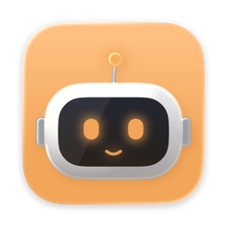
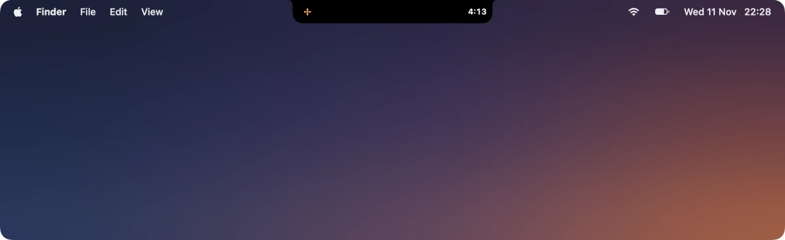
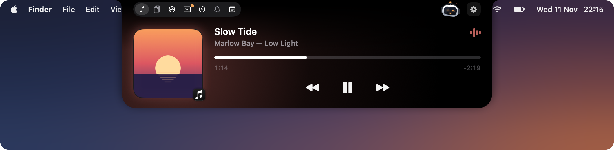
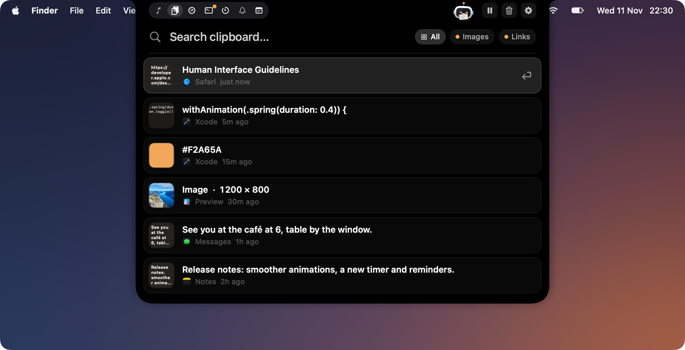
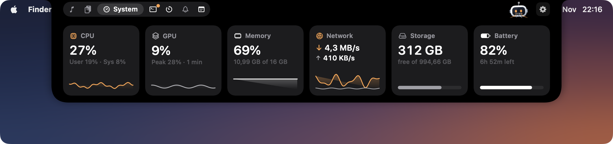
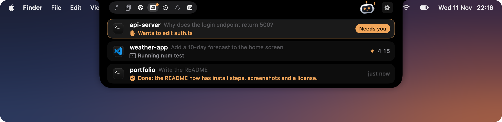
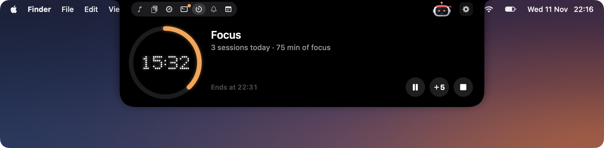
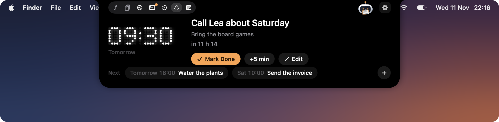
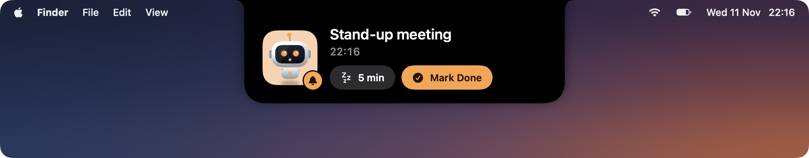
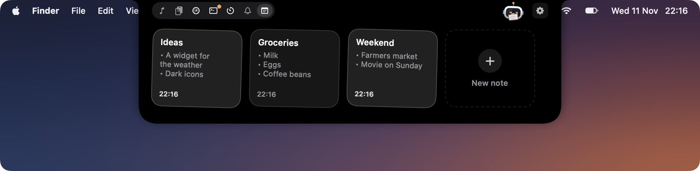

<p align="center">
  
</p>

<h1 align="center">PNotch</h1>

<p align="center">
  <b>Your MacBook's notch, put to work. With a little robot living in it.</b><br>
  Music, clipboard, system stats, a focus timer, reminders, notes and your Claude Code sessions, one hover away.
</p>

<p align="center">
  <a href="https://github.com/theo-mrn/PNotch/releases/latest"></a>
  <a href="https://github.com/theo-mrn/PNotch/releases"></a>
  <a href="https://github.com/theo-mrn/PNotch/actions/workflows/ci.yml"></a>
  
  
  <a href="LICENSE"></a>
</p>

<p align="center">
  <a href="https://github.com/theo-mrn/PNotch/releases/latest/download/PNotch.dmg"></a>
</p>

<p align="center">
  <sub>Free and open source · macOS 14 Sonoma or later · Apple silicon and Intel · English and French</sub>
</p>

<p align="center">
  
</p>

PNotch turns the black camera housing of your MacBook into a small, quiet control center. Hover it and it unfolds under the menu bar. Move away and it folds back. In between, **Pixel**, a small robot, lives up there: it dances to your music, reads your clipboard, sweats when the processor works hard and calls you when Claude Code needs an answer.

- **Native and light.** SwiftUI and Swift 6, no web view. Pages only take their readings while they're on screen.
- **Yours.** No account, no analytics. Your clipboard, notes and reminders stay on your Mac.
- **Keyboard friendly.** Open the clipboard with <kbd>⌃⌘V</kbd>, then type, arrow, <kbd>↩</kbd>.
- **Pick your pages.** Every page is a module you plug in or out, in any order.
- **No notch? No problem.** On a display without one, PNotch draws its own.

## Features

### Music

What's playing in Music, Spotify, a podcast app or a browser tab: the cover, a progress bar you can drag, and play, pause and skip. While a song plays, the closed notch widens around the camera with the cover and a small equalizer.



### Clipboard

Everything you copy, in a searchable list. Colors show as swatches, code keeps its syntax colors, links get their page preview, and images and files show as thumbnails. Pick an item and it is pasted straight into the app you were using.

- <kbd>⌃⌘V</kbd> opens the list with the cursor in the search field; press it again to move down.
- Filter by images or links. Pin what you reuse.
- Passwords copied from password managers are never recorded.



### System

CPU, GPU, memory, network, storage and battery, each with its last minute as a chart. One click opens Activity Monitor.



### Claude Code

Every [Claude Code](https://www.anthropic.com/claude-code) session at a glance: the project, your last prompt and what Claude is doing right now. When a session needs you, the notch says so, and you can allow or deny a permission request without leaving what you're doing. Click a session to jump back to its terminal or editor.

Connecting adds a hook to `~/.claude/settings.json`, with a backup. Events travel through a local socket only your account can open.



### Focus timer

25/5 or 50/10 focus sessions, or a stopwatch. The countdown stays around the closed notch, Pixel puts on a headband and works with you, and a chime starts your break.



### Reminders

Type it the way you'd say it, in English or French: "call Lea tomorrow at 2pm", "take out the trash every Monday at 7pm". When it's time, Pixel calls you with a « ! », a chime plays and the notch opens on it.




### Notes

A sheet of paper across the notch, a list of notes, or sticky notes side by side: your choice. Notes save as you type.



### Pixel

Pixel is drawn live, with a metal body, a glass visor and eyes that follow your pointer. Its mood follows your Mac, and it carries the news: a copy, a finished Claude Code turn, a reminder. Give it a name, colors and something to wear.

## Install

1. [Download PNotch](https://github.com/theo-mrn/PNotch/releases/latest/download/PNotch.dmg).
2. Open the DMG and drag PNotch to Applications.
3. Open PNotch and move the pointer to the notch.

PNotch is signed and notarized by Apple, so it opens without warnings. New versions install themselves.

To paste straight into other apps, PNotch needs the Accessibility permission (System Settings › Privacy & Security › Accessibility). It asks the first time; without it, items are copied and you paste them yourself.

## Using PNotch

| Gesture or key | What it does |
| --- | --- |
| Hover the notch | Opens it; moving away closes it |
| Click the notch | Opens it; on the clipboard, type to search right away |
| <kbd>⌃⌘V</kbd> | Opens the clipboard; again to move down, <kbd>↩</kbd> to paste |
| <kbd>⌥</kbd> <kbd>↩</kbd> / <kbd>⇧</kbd> <kbd>↩</kbd> | Copy only / paste as plain text |
| <kbd>⌘P</kbd> / <kbd>⌘⌫</kbd> | Pin / delete a clipboard item |
| Right-click Pixel | Pet it, and the current page's shortcuts |
| <kbd>esc</kbd> | Clears the search, then closes |

Everything else lives in Settings, from the menu bar icon or the gear in the notch.

## Roadmap

- [x] Music, clipboard and system monitor
- [x] Pixel, the companion
- [x] Claude Code sessions and permission requests
- [x] Focus timer, reminders and notes
- [x] Modules to pick and reorder
- [x] Automatic updates
- [ ] A file shelf, with AirDrop
- [ ] Your calendar's next event
- [ ] More live activities: charging, low battery, a new song
- [ ] Clipboard pinboards and apps to ignore
- [ ] Volume and lyrics for the music
- [ ] Install with Homebrew

Ideas and bug reports are welcome in [issues](https://github.com/theo-mrn/PNotch/issues).

## Building from source

You need Xcode 27 (Swift 6) on macOS 14 or later.

```sh
git clone https://github.com/theo-mrn/PNotch.git
cd PNotch
open PNotch.xcodeproj
```

Run the `PNotch` scheme. Swift packages are resolved by Xcode. In *Signing & Capabilities*, choose your own team. [CONTRIBUTING.md](CONTRIBUTING.md) covers the tests, the translations and the project's layout.

## Acknowledgements

- [boring.notch](https://github.com/TheBoredTeam/boring.notch) showed what a notch app can be, and PNotch's folder layout follows it.
- `NotchShape` is adapted from [DynamicNotchKit](https://github.com/MrKai77/DynamicNotchKit) (MIT).
- Now Playing relies on [mediaremote-adapter](https://github.com/ungive/mediaremote-adapter) by Jonas van den Berg (BSD 3-Clause), vendored in `Vendor/MediaRemoteAdapter`.
- [Sparkle](https://sparkle-project.org) for updates, and [Defaults](https://github.com/sindresorhus/Defaults) and [KeyboardShortcuts](https://github.com/sindresorhus/KeyboardShortcuts) by Sindre Sorhus.

## License

PNotch is released under the [MIT license](LICENSE).
